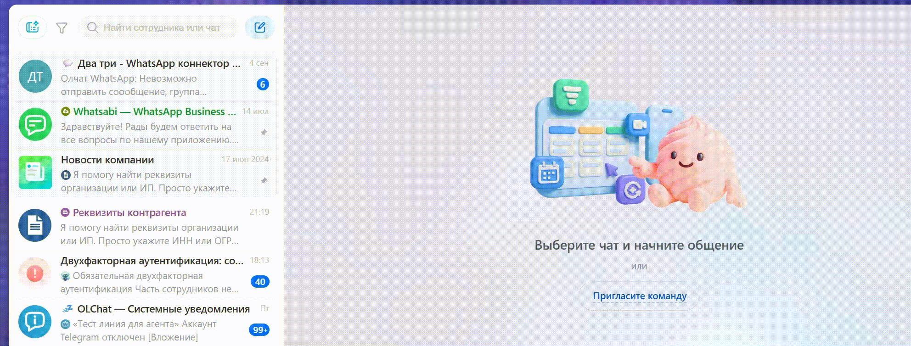

# Copy of Знакомство с Олчат Telegram

### Подключайте Telegram к Битрикс24 за 5 минут!

✅ Пишите первыми клиентам в Telegram прямо из карточки CRM (системы управления взаимоотношениями с клиентами).

✅ Отправляйте сообщения, изображения, документы, аудиофайлы.

✅ Получайте сообщения от клиентов, которые пишут в Telegram, прямо в Открытые линии Битрикс24.

✅ Записывайте, прослушивайте и отправляйте голосовые прямо из Битрикс24.

✅ Подключайте групповые чаты и Telegram-каналы.

✅ Добавляйте виджет на сайт.

✅ Получайте статусы отправки сообщений.

✅ Автоматизируйте различные процессы и сделайте общение с клиентами в мессенджерах быстрым и эффективным!

### Преимущества:

👍 Нет ограничений тарифа по количеству чатов, сообщений, количеству пользователей и переподключениям аккаунтов.

👍 Простое подключение через QR-код или авторизация по номеру телефона.

👍 Роботы и активити бизнес-процессов для настройки любой логики автоматизации.

👍 Подробная документация по настройкам и функционалу.

👍 Отзывчивая техподдержка, которая всегда на связи.

**Есть вопросы?** [**Напишите нам**](https://auth2.bitrix24.net/oauth/select/?preset=im\&IM_DIALOG=networkLines7c380c91ab28dacab02d3af93fecdbf9)**.**

### Как открыть чат поддержки из Битрикс24?

<figure><figcaption></figcaption></figure>

<figure><figcaption></figcaption></figure>

[Лицензионное соглашение](https://olchat.io/eula-ru)

[Условия о конфиденциальности](https://olchat.io/privacy-ru)
